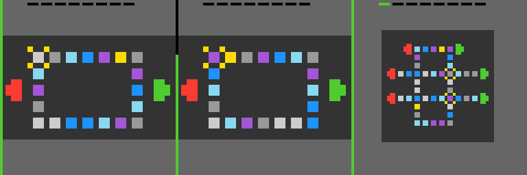
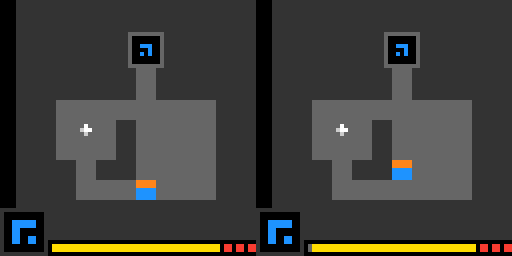

# Stage 1 failure investigation

The initial cold-start suite contains 225 completed runs with zero runtime errors.
It does **not** establish repeatable performance improvement: graph beat the
original no-repeat baseline on one of 75 game/seed pairs and tied on 74. That
baseline also used a different local ranking policy. The matched-policy rerun
removes this confound. Do not treat the initial score delta as evidence for BFS.

The trace audit assigns an explicit primary hypothesis to every incomplete run
in `audit.json`. Categories are diagnostic hypotheses from observed behavior,
not claims that an encoding bug or hidden mechanic has been proved. The following
representatives were inspected in detail, including their publicly downloaded
game source **after** the evaluation. No game-specific solution was added.

LP85 replay: initial board, last observation before progress, and the new level
after action 327. The independent replay reproduced the full observation hashes,
not just these displayed frames.

LS20 inspection: both player position and the lower resource UI remain in the
exact observation. Resource changes can fragment revisits, but removing them
without a verified model could merge states with different remaining allowances.

| Run from initial suite | Observed evidence | Classification and implication |
| --- | --- | --- |
| `lp85-305b61c3-graph-1` | First level completed at action 327 by click `(4,29)`; 1,000 total actions, 98.5% no-ops; 93 distinct click coordinates; no frontier replay. All 327 source/destination hashes reproduced exactly in an independent official-environment replay. | Partial success, followed by **action generation / lack of goal knowledge**. The success is real but cannot be attributed to BFS. The source maps display clicks onto rotation buttons; most lattice points miss meaningful controls. |
| `lp85-305b61c3-norepeat-1` | No levels, 99.0% no-ops, 258 distinct click coordinates, 1,000 actions. | **Action generation**. More distinct coordinates did not produce progress. Literal coordinate coverage is a poor proxy for testing distinct mechanical actions. |
| `ls20-9607627b-graph-0` | 384 distinct exact states in 389 actions; no frontier attempts; game-over at actions 129, 259, and 389; two recovery resets. | **State representation / environment-specific mechanic**, with **lack of goal knowledge**. The source has a movement-linked step counter and lives. Visible resource changes legitimately distinguish states, but the exact graph cannot transfer spatial knowledge across different remaining budgets. Blindly deleting the counter would merge mechanically different states. |
| `sb26-7fbdac44-graph-0` | Frontier selected after action 130 and reached at action 131; one-step recovery; no levels in 1,000 actions; 90.9% no-ops. All three initial seeds have one successful recovery and zero levels. | **Action generation / lack of goal knowledge**, rather than broken frontier replay. The source has selection, commit, undo, and animation phases. Reaching another experiment is insufficient to choose a useful sequence. This is the informative case for a larger, equal-budget comparison. |
| `ft09-0d8bbf25-graph-0` | Game-over at actions 41, 92, and 141; two recovery resets; 28 distinct click coordinates; no frontier recovery. | **Environment-specific mechanic / goal knowledge**. Clicks cycle coupled cell colors and consume limited meaningful moves. Favoring novel observations can spend the move allowance while moving away from the goal. Early termination here is not improved completion efficiency. |
| `ft09-0d8bbf25-random-2` | One level at action 469; 1,000 total actions and 86.3% no-ops; one reset. | Partial success by the random baseline. This counterexample prevents claiming that fewer no-ops or fewer actions alone proves a better solver. |

## What is and is not established

- **State/graph correctness:** no recorded counter inconsistency, unexplained
  repeated action, broken scorecard correspondence, or observation discontinuity
  was found in the complete initial suite. Exact state identity preserves visible
  mechanics. It does not guarantee the observations form a Markov state.
- **Frontier selection:** BFS replay is verified synthetically and in three public
  recoveries. It was invoked on only one of 25 public games in the initial suite.
  Most runs either retain untested local candidates or hit the game's resource
  limit before reusable exact paths are useful. This limits its measured value.
- **Goal knowledge:** the controller has sparse confirmed completion signals and
  action statistics, but no model of how colors, buttons, objects, or resources
  relate to a goal. A visible change is deliberately not treated as progress.
- **Action generation:** coarse-to-dense lattices are legal and systematic, but
  many pixel coordinates represent irrelevant background or equivalent controls.
  Exhaustively testing literal coordinates can dominate the available budget.

## Concrete limitations Stage 2 could address

1. Factor persistent layout/mechanic features from resource and animation context,
   while preserving resource values and verifying predicted transitions. This
   could transfer spatial knowledge without silently merging different budgets.
2. Predict action effects on coupled colors or linked rotations, then plan useful
   sequences within the remaining move allowance. The FT09 and LP85 inspections
   give specific examples of missing structure; novelty alone is insufficient.
3. Group mechanically equivalent click targets from observed effects, reducing
   wasted coordinate experiments without assuming all visually similar cells are
   interchangeable.

These are hypotheses for future experiments, not demonstrated improvements.
The completed SB26 sensitivity experiment (three paired seeds, 5,000 actions)
verified 64 recoveries per graph run and zero unexplained repeats, yet neither
controller completed any level. Graph visited 130 states versus no-repeat's 386
and averaged 92.9% versus 88.0% no-ops. Returning to old frontiers exposed many
legal but unhelpful click candidates; it did not supply the missing sequence/goal
knowledge. This is negative evidence for increasing the budget alone.

The matched LP85 seed-1 pair both complete a level at identical official score
0.6498470948012233; the initial graph-only win disappears with matched local
ranking. It cannot be attributed to BFS.

Stage 2 remains no-go until repeatable meaningful improvement is measured.
The performance target is not met by these diagnostics alone.

## Final matched-suite finding

All 225 matched-policy runs completed and passed the complete trace audit, with
no unexplained repeats or discrepancies against official action/level counts.
Graph and no-repeat tied on official score in all 75 paired comparisons, each
completing one level at the same action index. Graph verified three frontier
recoveries, all in SB26. The lack of measured value is therefore not explained
by a replay implementation failure: reusable frontiers were rare, and reaching
them did not overcome noisy click candidates or missing goal/mechanic knowledge.
Gate 4 remains unmet; Stage 2 is no-go on this evidence.
